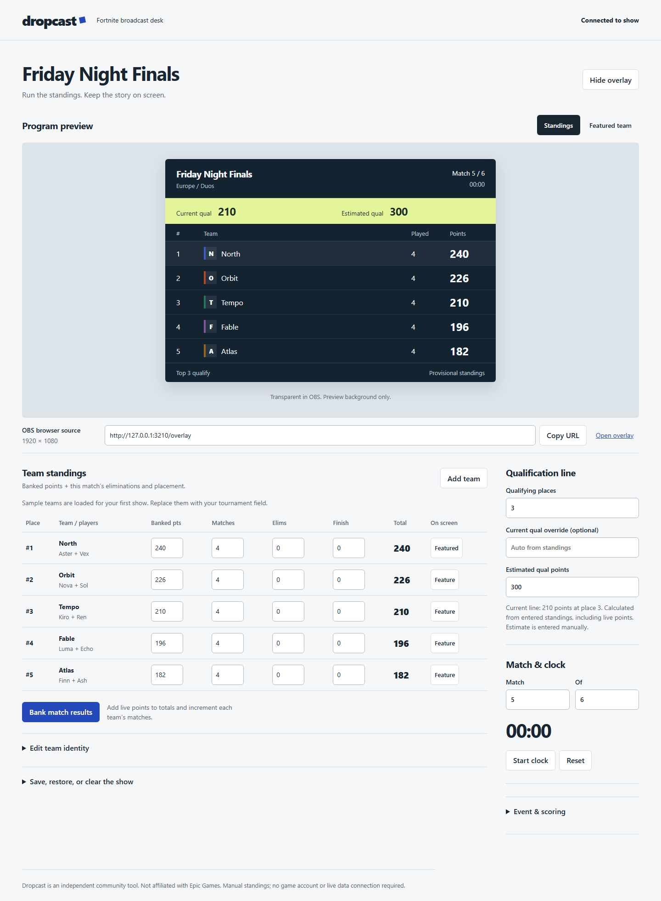

# Dropcast

A local-first broadcast desk for Fortnite tournaments. Control transparent OBS graphics from a separate operator page, with qualification lines and featured-team stats front and center.



## Start a broadcast

Requires **Node.js 22 or newer**. No dependencies, account, API key, or build step.

```sh
git clone https://github.com/saintzdid12/dropcast.git
cd dropcast
npm start
```

Open **http://127.0.0.1:3210** for the operator desk. In Windows PowerShell, use `npm.cmd start` if your execution policy blocks `npm.ps1`.

In OBS, add a **Browser** source, turn **Local file** off, set its URL to **http://127.0.0.1:3210/overlay**, and set the source size to **1920 × 1080**. The page background is transparent. Keep the Node process running while broadcasting. OBS and the operator browser must be on the same computer.

For a featured-team graphic, use **http://127.0.0.1:3210/overlay?view=featured**. Add both URLs as separate browser sources to switch views in OBS. The preview tabs change the preview and copied URL; they do not change an already-configured OBS source's layout.

## Broadcast fields

- **Current qual:** points at the last qualifying place, calculated from the entered field, including live points. Set **Current qual override** to use an external tournament cutoff. Leave it blank for automatic calculation. If the cutoff cannot be determined, the graphic shows a dash.
- **Estimated qual:** a manually entered forecast, never an automatic prediction.
- **Place #:** provisional rank by total points. Equal totals share a rank; alphabetical display order is not an official event tiebreaker. Under **Edit team identity**, set **Place override** to the official tournament rank when only tracking selected teams; `0` restores automatic ranking.
- **Match count:** each team's completed matches, independent of the broadcast's match number.
- **Featured team:** select **Feature** in the table, then use the featured overlay URL. Displays players, place, points, matches, and live eliminations.

The initial show contains fictional example teams and example scoring. Replace them before going live. Automatic rankings are only accurate for the teams you enter. Use manual rank and cutoff overrides when tracking a subset of a larger tournament. Official tie resolution remains the operator's responsibility.

## Running a match

1. Set the event, region, qualification places, estimated line, and actual scoring rules.
2. Enter **banked points** and completed matches for each team. Add logos (HTTP/HTTPS URLs), colors, and player names under **Edit team identity**.
3. Enter live eliminations and final placement as results arrive. **Finish = 0** means no placement points yet. Total = banked points + eliminations × elimination value + placement points.
4. **Bank match results** commits the live points, increments matches for **every listed team**, clears live eliminations/placement, resets the timer, and advances the broadcast match number if possible. Bank once per match. Remove non-participating teams or adjust their matches afterward.
5. Export a show JSON before destructive changes. Imports replace the entire current show after confirmation.

Team rows are editable and horizontally scrollable on small screens. Changes save on field blur/Enter and propagate to connected overlays over Server-Sent Events. The clock derives from a persisted timestamp, so page refreshes do not restart it.

## Overlay URLs

| Parameter  | Values                    | Default       |
| ---------- | ------------------------- | ------------- |
| `view`     | `leaderboard`, `featured` | `leaderboard` |
| `rows`     | `1`–`12`                  | `5`           |
| `position` | `right`, `left`, `bottom` | `right`       |

Example: `/overlay?rows=8&position=left`. Graphics have a 48px safe margin at broadcast widths. Resize/reposition the OBS source if needed.

## Storage and boundaries

The server binds to loopback only. It is designed for a single production computer, not public hosting or remote mobile operation. Writes check Host/Origin and validate input. Multiple operator tabs use revision checks to prevent silently overwriting a newer edit. A conflicting edit is rejected and the current show is reloaded.

Show state is atomically saved in `.dropcast/show.json` (ignored by Git). A corrupt saved file prevents startup rather than silently discarding results. Export backups and fix or move the corrupt file before restarting. On connection loss, overlays keep their last received graphic and show a connection warning until reconnected. Remote team logos still require network access.

Set `PORT` to change the default port. Example in PowerShell: `$env:PORT=3211` then `npm.cmd start`.

## Development

```sh
npm test
npm run check
node scripts/browser-smoke.mjs
```

The optional browser smoke check uses installed Chrome/Edge/Chromium (or `CHROME_PATH`) and a temporary show. It verifies operator interaction, live overlay updates, transparency, and responsive overflow. Unit/integration tests run on Windows, Linux, and macOS in GitHub Actions.

Built with browser-native JavaScript, CSS, Node HTTP, and Server-Sent Events. No framework or runtime packages. See [CONTRIBUTING.md](CONTRIBUTING.md).

MIT licensed. An independent community tool, not affiliated with or endorsed by Epic Games. No game login, game-client integration, scraping, or live Fortnite data feed.
